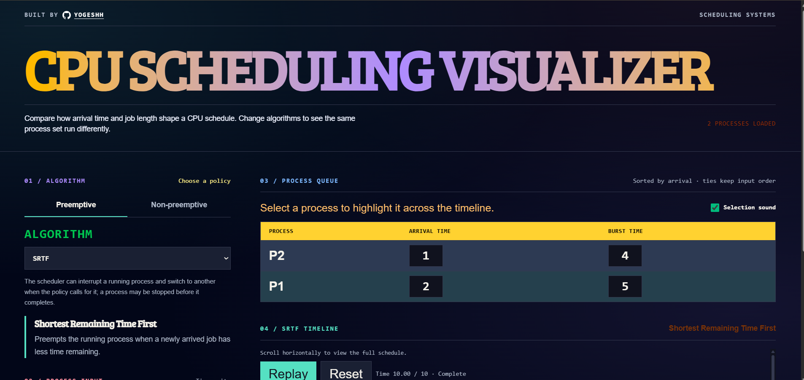

# CPU Scheduling Algorithm Visualizer

A visualizer for comparing different CPU scheduling algorithms. Built with Vite and Tailwind CSS + React + TypeScript .

## Screenshots



*SRTF visualization with process highlighting and a completed Gantt chart playback.*


## Implemented algorithms

- **FCFS** (First-Come, First-Served): runs processes in arrival order and does not preempt an active process.
- **SJF** (Shortest Job First, non-preemptive): from processes that have arrived, selects the shortest burst time.
- **SRTF** (Shortest Remaining Time First, preemptive): always runs the arrived process with the least remaining burst time.
- **Round Robin**: runs each ready process for a positive time quantum, then moves unfinished work to the back of the ready queue.
- **Priority** (preemptive): always runs the arrived process with the best priority. Lower integer values mean higher priority; equal priorities keep arrival and input order.

The ready queue uses arrival time, then input order, for deterministic tie-breaking. The simulator starts at time 0 and explicitly represents CPU idle periods while no process has arrived.

## Process inputs and metrics

- Arrival time must be a finite number of 0 or greater.
- Burst time must be a finite number greater than 0.
- Priority is required only for Priority scheduling and must be a safe integer.
- Round Robin requires a finite time quantum greater than 0.
- The process table is sorted by arrival time; equal arrivals remain in input order.

The Gantt chart shows process segments and idle periods, with remaining-time details for SRTF, Round Robin, and Priority segments. Use Play/Pause, Replay, Reset, or the playback slider to inspect the timeline. The chart scrolls horizontally for longer schedules.

The result includes average waiting time and average turnaround time, calculated across all added processes. Selecting a process highlights it in the timeline and can play a short selection sound; the sound can be disabled in the process queue controls.

This tool models CPU burst execution only. It does not model I/O blocking or I/O wait states.

## Prerequisites

- [Node.js](https://nodejs.org/) 20.19 or newer, or 22.12 or newer.
- npm, which is included with Node.js.

## Install and run

1. Clone the repository and open its project folder.
2. Install dependencies and start the development server:

   ```sh
   npm install
   npm run dev
   ```

3. Open the URL printed by Vite (by default, `http://localhost:5173/`) in a browser.

Create a production build with `npm run build`; TypeScript is checked before Vite builds the app. Run scheduler and validation tests with `npm test`. Run only the TypeScript check with `npm run typecheck`. Preview a build locally with `npm run preview`.

Tailwind CSS is integrated through the Vite plugin configured in `vite.config.ts`.

## Project structure

- `index.html` - HTML page entry point.
- `src/main.tsx` - React application entry point.
- `src/App.tsx` - visualizer screen, algorithm controls, and process-entry behavior.
- `src/scheduler.ts` - validation and all scheduling algorithms.
- `src/components/ProcessTable.tsx` and `src/components/GanttChart.tsx` - reusable process queue and schedule visualization components.
- `src/scheduler.test.ts` - scheduler and validation tests.
- `src/styles.css` - Tailwind import and small custom process/Gantt styles.
- `vite.config.ts` and `tsconfig.json` - Vite/Tailwind and TypeScript configuration.
